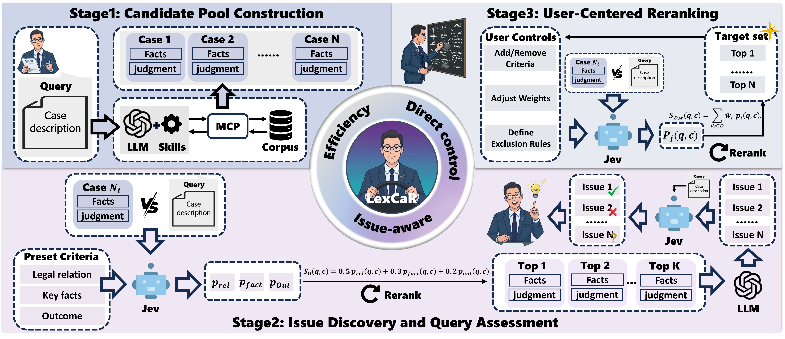
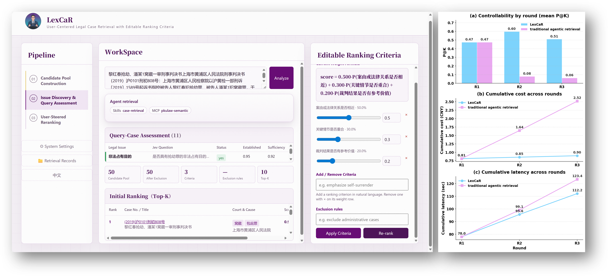

<div align="center">


</div>

<br>

<div align="center">


[](https://www.python.org/)
[](#-method--three-stages)
[](./LICENSE)

**LexCaR** is a user-centered legal case retrieval system with editable ranking criteria:
build a reusable candidate pool once, then refine ranking under evolving user focus—without restarting the retrieval loop.

*Issue-aware guidance · Direct control · Efficiency*

### 🚪 Start here

| Who | Where |
|:--|:--|
| **Try the demo** | [`web_server.py`](./web_server.py) / [`pipeline.py`](./pipeline.py) · local Web UI & CLI |
| **Read the method** | [Method · Three stages](#-method--three-stages) · candidate pool → issue discovery → user-steered reranking |
| **Reproduce experiments** | [`experiment/`](./experiment/) · controllability / cost / latency vs. full agentic re-retrieval |

[Introduction](#-introduction) ·
[Design](#-design-properties) ·
[Method](#-method--three-stages) ·
[Findings](#-main-findings) ·
[Usage](#-usage) ·
[Citation](#-citation)

</div>


> [!WARNING]
> ### ⚖️ Disclaimer
>
> LexCaR is a **research / demo** system for interactive legal case retrieval. It does **not** provide legal advice, a formal legal opinion, or a substitute for a licensed attorney.
>
> - Rankings, issue checklists, and Jev assessments are **decision-support signals**, not determinations of law or fact.
> - Case text comes from third-party databases (e.g. PKULaw); you must comply with their terms and obtain your own credentials.
> - Final legal judgment remains with qualified legal professionals, who bear responsibility for any use of the outputs.


## 📖 Introduction

Legal case retrieval helps legal professionals find previous cases that inform their analysis of a new case. However, a user’s purpose may change as they examine retrieved judgments, so the target cases they consider relevant can change within the same session. Existing methods either keep ranking criteria fixed, unable to follow the user’s evolving focus, or re-run the whole loop at every focus shift, which drives up latency and cost.

To address this, we present **LexCaR**, a user-centered legal case retrieval system with editable ranking criteria.


## 🧩 Design Properties

<table>
<tr>
<td width="33%" valign="top">

#### 🧭 Issue-aware guidance

Surfaces atomic legal issues attended to in prior judgments and assesses whether each holds under the query facts—suggesting directions for fine-grained retrieval.

</td>
<td width="33%" valign="top">

#### 🎛️ Direct control

Add or remove criteria, adjust weights, and define exclusion rules to steer ranking toward the preferred legal angle—without burying decisions inside an opaque agent loop.

</td>
<td width="33%" valign="top">

#### ⚡ Efficiency

Builds a reusable candidate pool once and re-ranks it on each focus shift, avoiding replanning and external retrieval—cheaper and faster than restarting the loop.

</td>
</tr>
</table>


## 🔧 Method · Three Stages

<p align="center">
  
  <br>
  <em>Figure 1: Method of LexCaR</em>
</p>

### Stage 1 · Candidate Pool Construction

Given a query case, LexCaR constructs a candidate pool from external legal case databases via MCP with an agentic retriever. Retrieval is driven by a built-in (replaceable) retrieval skill; the retriever may run several search rounds until the target pool size is reached. Users can swap the skill and set rounds / pool size for customized pools.

### Stage 2 · Issue Discovery and Query Assessment

1. **Preset-criteria reranking** — Jev scores each candidate on legal-relationship similarity, key-fact similarity, and precedential value.
2. **Legal issue extraction** — An LLM analyzes judicial reasoning of top-ranked cases and produces a checklist of atomic legal issues.
3. **Query-case assessment** — For each issue, Jev judges whether it is established by the query facts and whether the query text is sufficient (yes / no / unknown).

### Stage 3 · User-Steered Reranking

Users edit the ranking specification (add/remove criteria, adjust weights, define exclusion rules). The candidate pool is reused; Jev re-evaluates active criteria at each rerank, and LexCaR shows the updated ranking with per-criterion contributions.


## 📊 Main Findings

<p align="center">
  
  <br>
  <em>Figure 2: The performance of LexCaR</em>
</p>

We compared LexCaR and a traditional agentic retriever on the same LLM (GPT-4o-mini), with legal experts running 3 interactive rounds over 50 queries. Round 1 shared a PKULaw MCP candidate pool. In Rounds 2–3, experts proposed focus shifts: LexCaR re-ranked the shared pool; the baseline re-ran full retrieval. Gold labels were experts’ target sets on the Round-1 pool.

| | Round 2 | Round 3 | Cumulative (by R3) |
|:--|:--:|:--:|:--:|
| **LexCaR** P@K | ≈ 0.60 | ≈ 0.51 | ¥0.90 · 112.2 s |
| **Agentic re-run** P@K | ≈ 0.06–0.08 | ≈ 0.06–0.08 | ¥2.52 · 123.4 s |

Aggregate tables & plotting scripts: [`experiment/results/`](./experiment/results/) · [`experiment/README.md`](./experiment/README.md)


## 📂 Repository Structure

```text
LexCaR/
├── pipeline.py              # CLI entry (stages 1 / 2 / 3 / all)
├── demo_interactive.py      # Interactive terminal demo
├── web_server.py            # Local web UI
├── config.py                # Settings loaded from .env
├── clients/                 # LLM, Jev, MCP, skills
├── stages/                  # Stage1 / Stage2 / Stage3
├── skills/                  # Retrieval skill prompts (SKILL.md)
├── mcp/                     # MCP server endpoint configs
├── data/                    # LeCaRDv2 loader (+ optional local data)
├── experiment/              # Efficiency / controllability scripts & results
├── web/                     # Frontend
├── figures/                 # Paper figures & UI assets
├── assets/                  # README banner (PNG) & dividers
├── .env.example             # Configuration template
├── requirements.txt
└── LICENSE
```


## 🚀 Usage

### Requirements

- Python 3.10+
- [DMXAPI](https://www.dmxapi.cn) key for LLM + Jev (`DMX_API_KEY`)
- Optional MCP tokens for PKULaw / Wolters Kluwer case search

### Installation

```bash
git clone https://github.com/kunranLi/LexCaR.git
cd LexCaR
python -m venv .venv

# Windows
.venv\Scripts\activate
# macOS / Linux
# source .venv/bin/activate

pip install -r requirements.txt
cp .env.example .env   # then fill in DMX_API_KEY and optional MCP tokens
```

### Run CLI

```bash
python pipeline.py --stage all --demo
python pipeline.py --stage all --query "Your case description..."
python demo_interactive.py
```

### Run Web UI

```bash
python web_server.py
# open http://127.0.0.1:8765 (default; see --help)
```

### Optional data & experiments

Local LeCaRDv2 files are **not** shipped. Place them under `data/lecardv2/` for `--qid` support — see [`data/lecardv2/README.md`](./data/lecardv2/README.md) · [THUIR/LeCaRDv2](https://github.com/THUIR/LeCaRDv2).

```bash
python -m experiment.run_efficiency_controllability --qid "00000,00002" --pool-size 15 --n-shifts 2
python -m experiment.plot_round_curves --exp-dir experiment/results/exp_eff_ctrl_n50_combined
```

Configuration lives in `.env` (from `.env.example`). MCP endpoints under `mcp/` use `${PKULAW_MCP_TOKEN}` / `${WK_MCP_TOKEN}` — never commit real tokens.


## 📜 Citation

```bibtex
@inproceedings{lexcar2027,
  title     = {{LexCaR}: User-Centered Legal Case Retrieval with Editable Ranking Criteria},
  booktitle = {Proceedings of the 49th European Conference on Information Retrieval ({ECIR} 2027), Demo Track},
  year      = {2027},
  note      = {Code and live demo: \url{https://github.com/kunranLi/LexCaR}},
}
```

## 📄 License · Terms

This project is released under the [MIT License](./LICENSE).

Third-party case databases (PKULaw, Wolters Kluwer, LeCaRDv2) remain under their respective terms; obtain your own access credentials and comply with their licenses.
